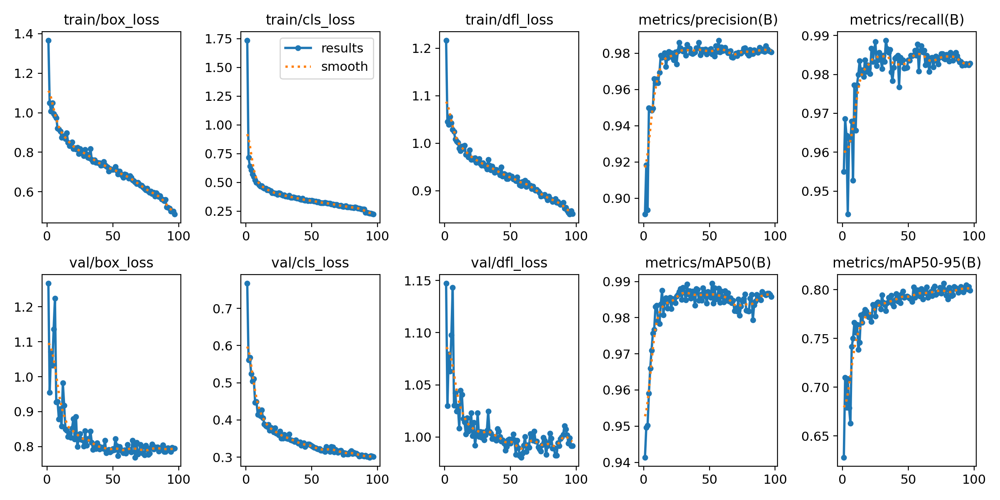
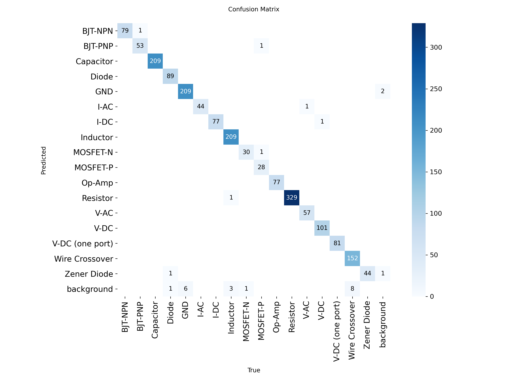
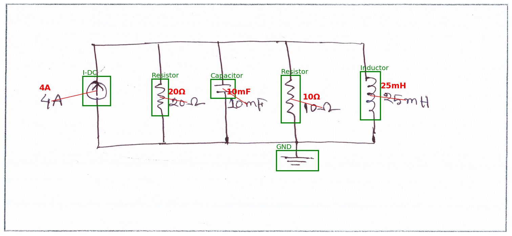

# Handwritten circuit diagram recognition

Find every component in a hand-drawn circuit diagram and say what it is (Digitize-HCD dataset, 17 classes). As a bonus, also read the value written next to each component (e.g. `1kΩ`, `5V`) and attach it to the right component.

| Part | Approach | Test result |
|---|---|---|
| **Task 1: component detection** | YOLO11m fine-tuned at 1024 px | **mAP50 0.989, mAP50-95 0.810**; 98.6 % of components found with the correct class |
| **Bonus: value reading** | Text detector (YOLO11s) + fine-tuned TrOCR + unit-aware matching | **90.0 %** of values found, read exactly and attached to a component of a compatible class |

A short report with the reasoning behind each choice is in [`Report.md`](Report.md).

Both notebooks are public on Kaggle with all outputs, so every reported number can be checked without retraining:
   - Task 1: [circuit-component-detector](https://www.kaggle.com/code/diegofogued/circuit-component-detector)
   - Bonus: [value-reading](https://www.kaggle.com/code/diegofogued/value-reading)

## Repository contents

```
task1_detection/
├── circuit-detector.ipynb          # data checks, split, training, evaluation, error analysis (shared without outputs)
└── results/                        # metrics (val/test), split.csv, training log and args, figures
task2_value_reading/
├── value-reading.ipynb             # text detection, reading, matching (with outputs)
└── results/                        # values_summary.json, text detector log and args, figures
Report.md                          # short report (1-2 pages)
LLM_USAGE.md                        # prompts and responses of the LLM used during the task
```

**Trained weights and all run outputs** are in the [Release](../../releases):
- `submission_outputs.zip` (Task 1): component detector at `yolo11m_1024/weights/best.pt`, curves, confusion matrices, per-class metrics, `split.csv`.
- `values_outputs.zip` (bonus): text detector at `text_yolo11s_1024/weights/best.pt`, curves, metrics and the example figure.

The fine-tuned TrOCR reader (~1.3 GB) is not distributed; the bonus notebook retrains it in about 22 minutes.

## Dataset

**Digitize-HCD**, Mendeley Data, V1, DOI [10.17632/rngcz5wtv8.1](https://data.mendeley.com/datasets/rngcz5wtv8/1), licence CC BY 4.0. 1,277 scanned hand-drawn circuit diagrams. Only the folder `Component Symbol and Text Label Data` is used:
- `component_annotations.json`: component boxes, COCO format, 17 classes.
- `text_annotations.json`: text labels with box and transcription (bonus only).

The dataset is not included in this repository. Download it from Mendeley, or attach it in Kaggle as a dataset.

## How to run

1. **Task 1:** import `task1_detection/circuit-detector.ipynb`, attach the Digitize-HCD dataset and run all cells.
   - Keep `RUN_TEST = False` while developing; set it to `True` for the final run. The test set is evaluated once, recorded in `TEST_DONE.txt`.
   - Training takes about 2 hours. Output: `submission_outputs.zip`.
2. **Bonus:** upload `submission_outputs.zip` (from step 1 or from the Release) to Kaggle as a dataset. Then import `task2_value_reading/value-reading.ipynb`, attach that dataset and Digitize-HCD, and run all cells.
   - It reuses the Task 1 split and component detector without retraining.
   - It trains the text detector (~30 min) and fine-tunes TrOCR (3 epochs, ~22 min).
   - Same test protocol, recorded in `TEST_DONE_values.txt`. Output: `values_outputs.zip`.

All paths are found automatically. Retraining gives close but not bit-identical numbers (GPU training is not fully deterministic).

## Task 1: component detection

### Method
- **Data checks:** all images present, box sizes, class imbalance. Boxes are clipped to the image; boxes with a side under 5 px are removed.
- **Split:** 80/10/10 **by image** (1,021 / 128 / 128), so no drawing appears in two splits. It is stratified on each image's rarest class.
- **Model:** YOLO11m pretrained on COCO, `imgsz=1024` so small symbols stay visible. Up to 100 epochs with early stopping (patience 20), batch 4, no horizontal flips, ±5° rotation.
- **Protocol:** every decision is made on validation. The confidence threshold (0.78) is the best-F1 point on validation and is reused on test. The test set is evaluated once.

### Results

| Split | Images | Components | mAP50 | mAP50-95 | Precision | Recall |
|---|---|---|---|---|---|---|
| Validation | 128 | 1,914 | 0.987 | 0.808 | 0.983 | 0.984 |
| **Test** | **128** | **1,894** | **0.989** | **0.810** | **0.986** | **0.985** |

- Best epoch 77 of 97 (early stopping), 1.9 h on one T4.
- At the 0.78 threshold on test: 19 components missed, 7 misclassified and 3 false alarms.
- Class errors are look-alike pairs (BJT PNP/NPN, MOSFET P/N, Diode/Zener, V-AC/I-AC, V-DC/I-DC). Most misses are small symbols (Wire Crossover 8, GND 6).
- The lowest mAP50-95 values (V-DC one port 0.70, GND 0.74) come from less tight boxes, not from missed components.

Per-class metrics: [`task1_detection/results/test_per_class_metrics.csv`](task1_detection/results/test_per_class_metrics.csv).

| Training curves | Test confusion matrix |
|---|---|
|  |  |

## Bonus: value reading

### Method
1. **Components:** the Task 1 detector, reused without retraining (threshold 0.78).
2. **Text detector:** YOLO11s with a single class `text`, same split and recipe. One class without fine distinctions, so a small model is enough.
3. **Reader:** TrOCR (`microsoft/trocr-base-handwritten`) fine-tuned on the ~9,500 training crops for 3 epochs; the best epoch on validation is kept (epoch 3). The loss is computed explicitly, because in transformers 4.57 the built-in loss of this model shifts the labels a second time.
4. **Matching:** the unit restricts the possible classes (`Ω` → resistor, `F` → capacitor, `H` → inductor, `Hz`/`sin` → AC sources, `V` → voltage sources, `A` → current sources). The text goes to the nearest allowed component. A value without a unit takes it from the class (`1k` next to a resistor → `1kΩ`).

### Results

| Stage | Validation | **Test** |
|---|---|---|
| Text detector, mAP50 / mAP50-95 | 0.995 / 0.786 | **0.995 / 0.793** |
| Reader on true text boxes, exact match | 0.916 | **0.911** |
| Reader on true text boxes, character error rate | 0.039 | **0.050** |
| End to end: text found | 0.990 | **0.997** |
| End to end: found and read exactly | 0.902 | **0.901** |
| End to end: found, read and attached | 0.898 | **0.900** |

- **Fine-tuning is essential:** TrOCR without training reads only 10.9 % of the validation labels exactly. It reads `μ` as `M` (`5MF` instead of `5μF`) and fails on `Ω`.
- **Reading is the bottleneck:** almost every text is found (99.7 % on test), and almost every text read correctly is attached (90.0 % of 90.1 %).
- **Remaining reading errors:** prefixes (`m`/`M`/`μ`), repeated digits (`77V` for `7V`) and formula formats (`20sin5tV`).
- **Matching is checked only indirectly**, because the dataset has no text-to-component links. "Attached" means attached to a component of a class that fits the unit, not necessarily the right instance. On the true boxes (validation), the nearest value-carrying component already fits the unit for 94.9 % of the texts that have a unit; the unit rule changes the choice for 5.1 % of all texts.



## Licences

- Dataset: CC BY 4.0 (Digitize-HCD).
- Ultralytics YOLO: AGPL-3.0.
- TrOCR weights: see the `microsoft/trocr-base-handwritten` model card.
- An LLM (Claude) was used during the task; prompts and responses are in [`LLM_USAGE.md`](LLM_USAGE.md).
